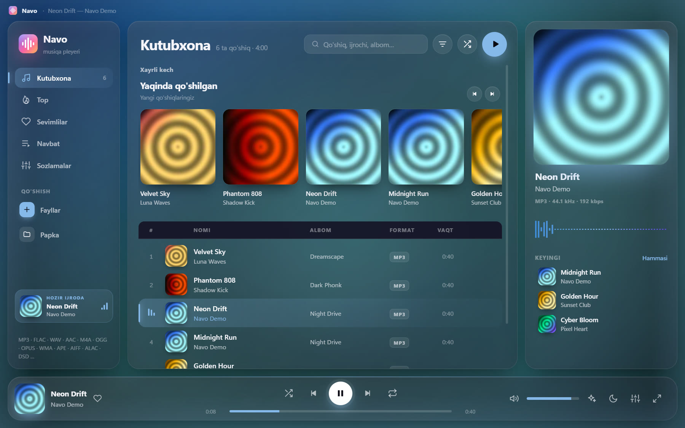

<p align="center"></p>
<h1 align="center">Navo</h1>
<p align="center"><b>Musiqangizni his qiling.</b><br>Barcha formatlarni o'ynaydigan, bass bilan sinxron effektli, bepul musiqa pleyeri — Windows va Android uchun.</p>

<p align="center">
  <a href="https://javohir877.github.io/navo/"><b>🌐 Sayt</b></a> ·
  <a href="https://github.com/Javohir877/navo/releases/latest/download/Navo-Setup.exe"><b>⬇ Windows</b></a> ·
  <a href="https://github.com/Javohir877/navo/releases/latest/download/Navo.apk"><b>⬇ Android</b></a>
</p>



## Imkoniyatlar

- **Bass bilan sinxron effektlar** — qo'shiq oldindan tahlil qilinadi, effektlar har bir 808 zarbasiga aniq tushadi; drop'larda "mega" effekt, sokin qismlarda jimlik.
- **Uslubni avtomatik aniqlash** — Phonk, Rep, Elektron, Pop yoki Sokin musiqa uchun turli effektlar.
- **Audio effektlar** — Slowed + Reverb, Nightcore, Sped up, 8D audio.
- **Qo'shiq matni** — karaoke uslubida, slowed versiyalar uchun vaqt avtomatik moslashadi (LRCLIB).
- **Barcha formatlar** — MP3, FLAC, WAV, M4A/AAC, OGG, OPUS; Windows'da qo'shimcha WMA, APE, AIFF, ALAC, DSD va boshqalar (ffmpeg orqali).
- **Muqovalar** — fayldan, papkadagi `cover.jpg` dan yoki internetdan (iTunes/Deezer) avtomatik; qo'lda o'zgartirish ham mumkin.
- **Top**, sevimlilar, navbat, 10 polosali ekvalayzer, uyqu taymeri.
- Windows: "Open with" ro'yxati, vazifalar paneli tugmalari, media tugmalar.
- Android: fonda ijro va bildirishnomada boshqaruv.

## Ishlab chiqish

```bash
npm install
npm start            # Windows (Electron) versiyasini ishga tushirish
npm run build:exe    # dist/ ga o'rnatuvchi va portativ .exe
```

Android (JDK 21 va Android SDK kerak):

```bash
npx cap sync android
cd android && ./gradlew assembleRelease
```

Release APK'ni imzolash uchun `android/keystore.properties` va kalit fayli kerak (ular repozitoriyga qo'shilmaydi).

## Tuzilma

| Papka | Nima bor |
|---|---|
| `www/` | Umumiy interfeys (HTML/CSS/JS) — Windows va Android uchun bitta kod |
| `electron/` | Windows ilovasi: fayllar, metadata, ffmpeg konvertatsiya |
| `android/` | Capacitor Android loyihasi, fon ijrosi xizmati |
| `docs/` | Yuklab olish sayti (GitHub Pages) |
